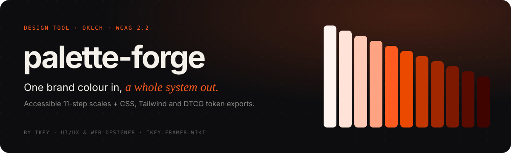

<p>
  <a href="https://oluwafey1kem1.github.io/palette-forge/"></a>
  
  
  
</p>

Most small-business clients arrive with one brand colour and nothing else. Then you need a hover state, a light background tint, a dark section, borders, muted text… **palette-forge** turns that one colour into a full, accessible palette in a second.


## What you get

- **11-step scale** (50 → 950) built in **OKLCH**, so steps look evenly spaced to the eye — unlike HSL, where yellows wash out and blues go muddy
- **Your exact colour stays in** — it's pinned to the nearest step (toggleable)
- **A tinted neutral scale** with a hint of your hue, so greys feel on-brand
- **Gamut-safe** — chroma is reduced automatically until every step fits in sRGB
- **Contrast matrix** — every step against white, black, 50 and 950 with AA / AAA labels
- **Live preview** — a hero + cards built only from the generated tokens
- **Exports:** CSS custom properties (with semantic aliases), Tailwind v3 config + v4 `@theme`, and **DTCG design tokens** JSON (works with Tokens Studio)
- **Shareable** — the colour lives in the URL: `…/palette-forge/#1F7A5A`

## Using the output in Framer

1. Copy the **CSS variables** tab
2. Create Framer colour styles named `brand/50` … `brand/950` with those values (or paste into a code component's `:root`)
3. Use `brand/500` for primary buttons, `brand/600` for hover, `brand/50` for tinted sections, `neutral/600` for muted text

## How the scale is built

```
L (lightness):  .975 .935 .88 .80 .71 .63 .545 .465 .385 .30 .235
C (chroma):     brand chroma × [.10 .22 .42 .68 .90 1 .94 .84 .70 .56 .46]
H (hue):        brand hue, drifting ~1.2° per step toward warmer darks
```

Then each step is gamut-mapped to sRGB by binary-searching the maximum chroma that fits. Colour maths uses Björn Ottosson's OKLab matrices; contrast follows the WCAG 2.x relative-luminance formula.

## Run it

It's one HTML file. Open `index.html`, or use the [live version](https://oluwafey1kem1.github.io/palette-forge/).

---

Built by **[Ikey](https://ikey.framer.wiki/)** — UI/UX & web designer. Need a full brand identity, not just a palette? [Let's talk](https://ikey.framer.wiki/contact).
